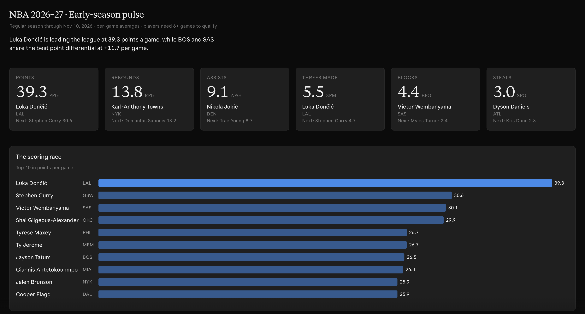

# Hoops Stats

Ask Claude about NBA player and team stats and get answers computed from real box scores: "What's Jokić averaging this season?", "Who leads the league in 3P%?", "How has Cooper Flagg played in his last 10 games?", "Mavericks points per game in the playoffs".

It also handles fantasy questions: "How many fantasy points does Shead score when Quickley sits?", "Rollins' best 3 games per week".

The plugin adds an MCP server with these tools and a skill that teaches Claude how to use them:

| Tool | What it does |
| --- | --- |
| `get_stat` | One player's or team's stats, filtered by season, playoffs, last N games, opponent, or which teammates played, as per-game, totals, or per-36 |
| `get_game_log` | Game-by-game lines, best games by any stat, and best-N-games-per-week summaries |
| `get_leaders` | Rank players or teams by a stat, including fantasy points, with minimums so small samples don't top the list |
| `save_fantasy_scoring` / `delete_fantasy_scoring` | Save your league's points per stat so `fpts` (fantasy points) works in every tool |
| `list_stats` | Available stats, saved scoring, loaded seasons, and the date of the most recent game |
| `refresh_data` | Download the latest games from stats.nba.com |

It covers box-score stats: points, rebounds, assists, steals, blocks, turnovers, minutes, plus/minus, and shooting, including TS% and eFG%, plus fantasy points under your league's scoring. It doesn't cover advanced metrics, play-by-play, standings, or rosters.

## Requirements

- **Where it works:** Claude Code, and Cowork sessions on your own computer. The server runs locally, so regular chat on claude.ai doesn't start it.
- **uv:** the plugin needs [uv](https://docs.astral.sh/uv/getting-started/installation/) installed. On macOS or Linux, run `curl -LsSf https://astral.sh/uv/install.sh | sh`. On Windows, run `powershell -c "irm https://astral.sh/uv/install.ps1 | iex"`. uv installs the right Python version for you.
- **No VPN while downloading:** stats.nba.com blocks most VPNs and cloud servers. Turn your VPN off when the plugin downloads data. Asking questions about data already downloaded works with or without a VPN.

The first start takes a minute or so while uv downloads Python and the server's packages. Later starts are fast.

## Install

**Claude desktop app (Cowork):** go to **Customize > Plugins > Add > Add marketplace**, enter `https://github.com/taylortyler-1/nba-stats-mcp`, then install **Hoops Stats**.

**Claude Code:**

```
/plugin install hoops-stats --marketplace taylortyler-1/nba-stats-mcp
```

## Use it

Just ask a question. The first time, there's no data yet, so Claude calls `refresh_data` to download the current season, which takes a few seconds, and then answers. You can also ask Claude to:

- "Refresh the NBA data" to pick up the latest games.
- "Load the 2023-24 season" to add an older season. Each season only needs loading once.

### Example: an early-season dashboard



[**NBA 2026-27 Early Season Dashboard**](https://claude.ai/artifact/K9uYRxzHexKuqtPWM4D675) was built in Cowork from Hoops Stats data on November 10, 2026. It shows:

- League leaders per game in points, rebounds, assists, threes, blocks, steals and true shooting.
- Season lines for Luka Dončić, Victor Wembanyama and Cooper Flagg.
- Points per game, point differential and 3P% for all 30 teams.

It's a snapshot from that date and doesn't update. Ask Claude for a dashboard like it once the plugin is installed, and it builds one from your current data.

## What it runs, sends, and stores

- **Runs:** a local Python MCP server, started with `uv run`. On first start, uv downloads Python and the packages pinned in `server/uv.lock` from PyPI.
- **Fetches:** game logs from stats.nba.com, only when `refresh_data` runs. Requests contain only the season and season type being downloaded.
- **Sends:** nothing else. The plugin sends nothing to any other service, and nothing about you or your questions is sent anywhere.
- **Stores:** a DuckDB database at `~/.local/share/nba-mcp/nba.duckdb`, a few tens of MB per season. Set the `NBA_MCP_DB` environment variable to store it elsewhere, or delete the file to remove the data.

This plugin isn't affiliated with or endorsed by the NBA. Data comes from the NBA's public stats site and is subject to its terms.

## Troubleshooting

- **The tools don't show up:** check that `uv` is installed and on your `PATH`. Desktop apps on macOS may not see a `PATH` set only in your shell profile, so restart the app after installing uv.
- **"Couldn't download from stats.nba.com":** the site doesn't respond to most VPNs and cloud servers; it stalls until the request times out (about 35 seconds). Turn your VPN off and try again. If you're not on a VPN, the site may be down; try again in a few minutes.

## Layout

- **`server/`:** the MCP server. Its [README](server/README.md) covers development and using the server without the plugin.
- **`skills/hoops-stats/`:** the skill, with reference docs on the tools, stats, and data.
- **`.claude-plugin/`:** the plugin and marketplace manifests.
- **`.mcp.json`:** how the plugin starts the server.
